# Servezy — Restaurant POS System

A production-grade, offline-first Restaurant POS (Point of Sale) system built with **Flutter (Desktop + Web)** and **FastAPI (Python)**. It is designed for busy restaurant environments, with real-time kitchen coordination, interactive floor plans, QR self-ordering and robust offline capabilities.

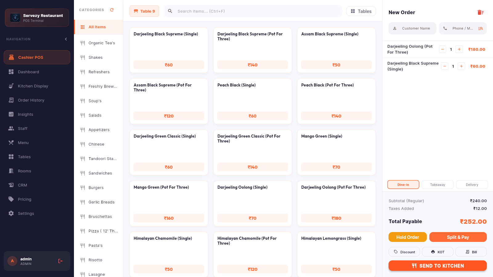

---

## 📸 Screenshots

| Login | Table Selection |
|:---:|:---:|
| 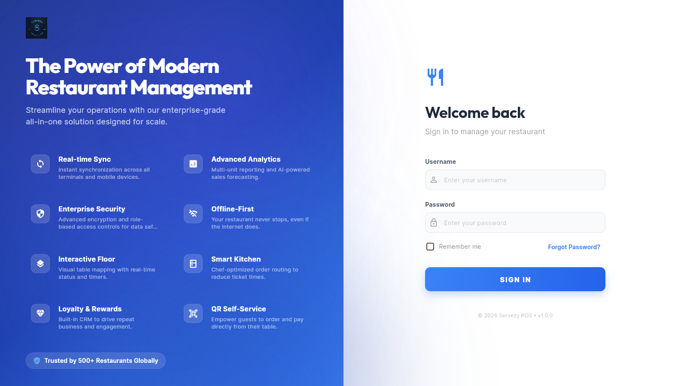 | 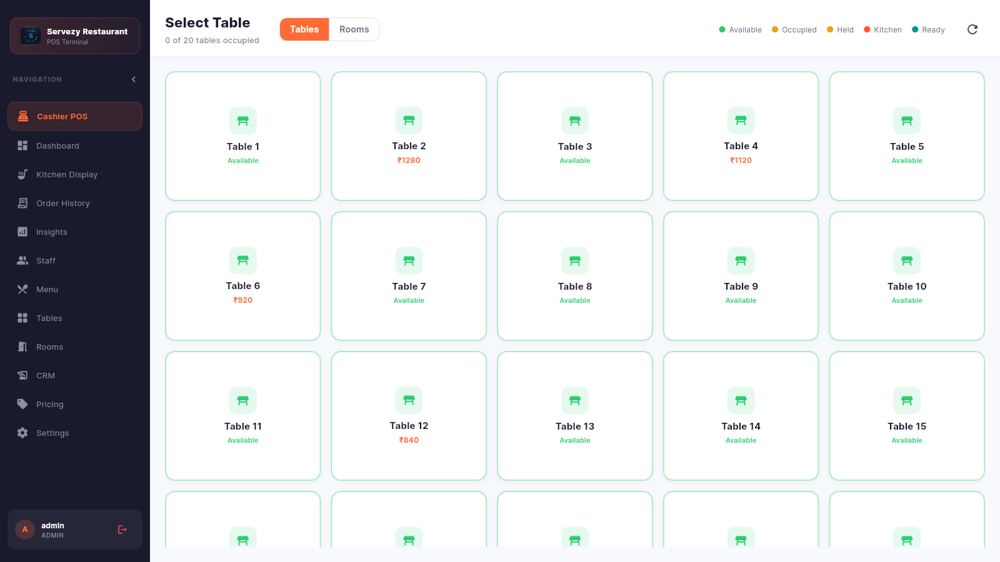 |

| Cashier POS | Kitchen Display System |
|:---:|:---:|
|  | 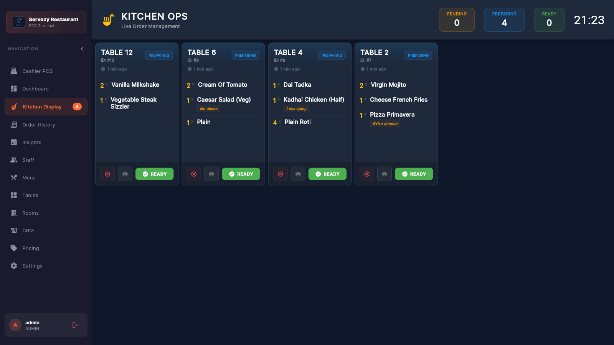 |

| Dashboard | Business Insights |
|:---:|:---:|
| 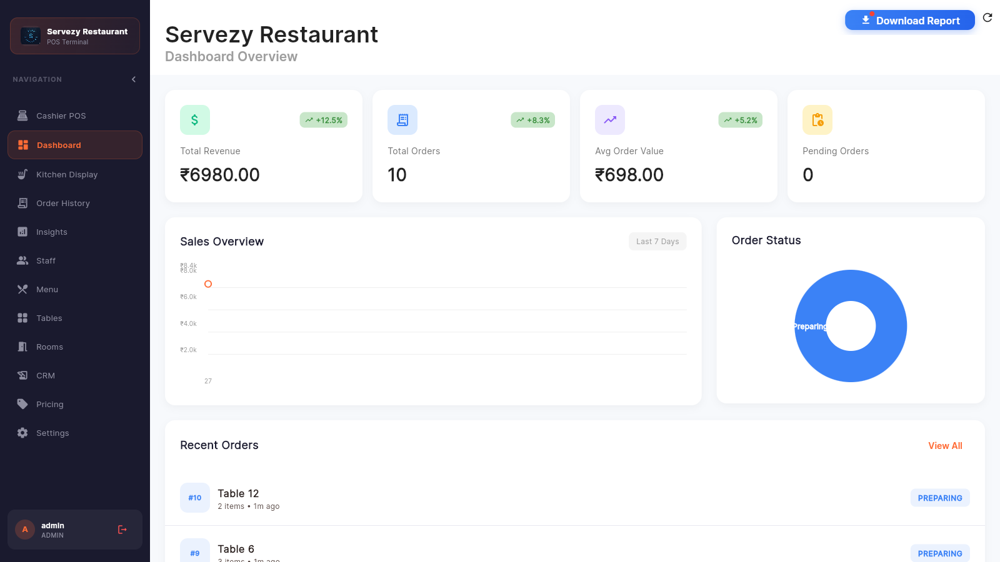 | 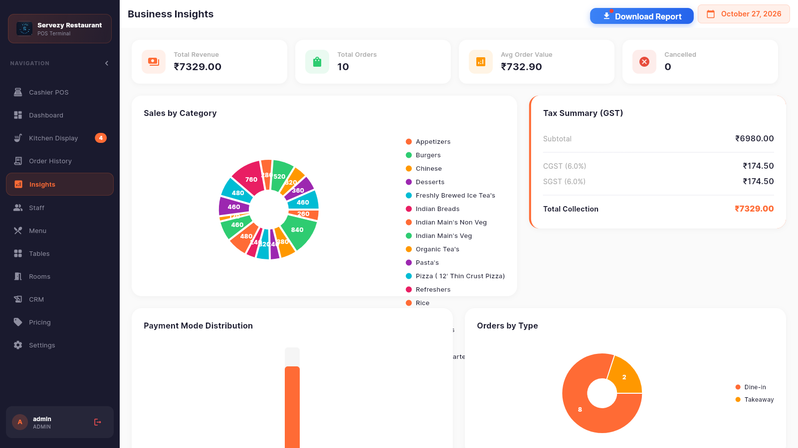 |

| Order History | Menu Management |
|:---:|:---:|
| 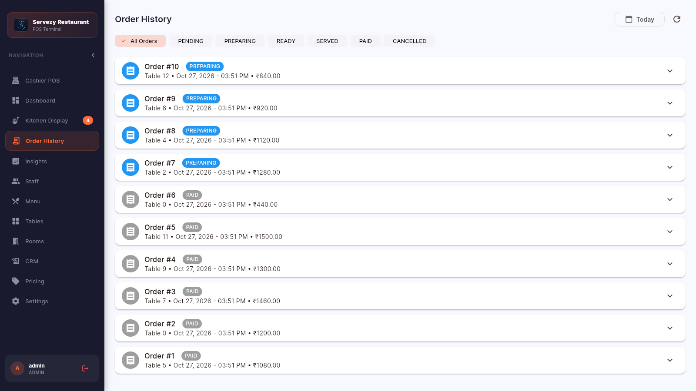 | 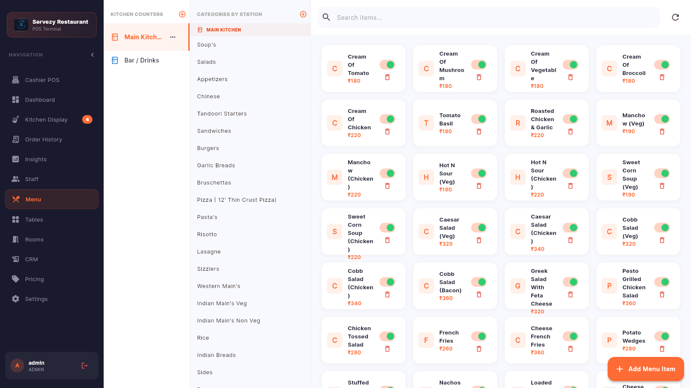 |

| Table Management | Staff & Attendance |
|:---:|:---:|
| 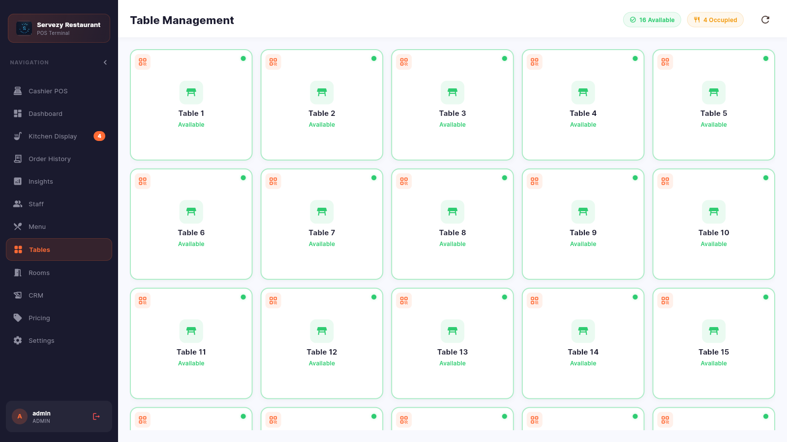 | 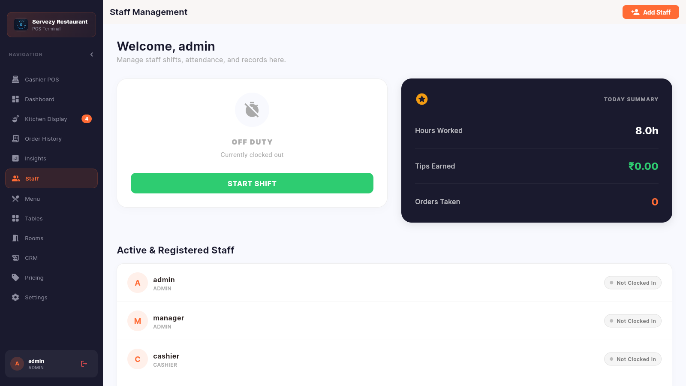 |

| Settings | Guest QR Menu (mobile) |
|:---:|:---:|
| 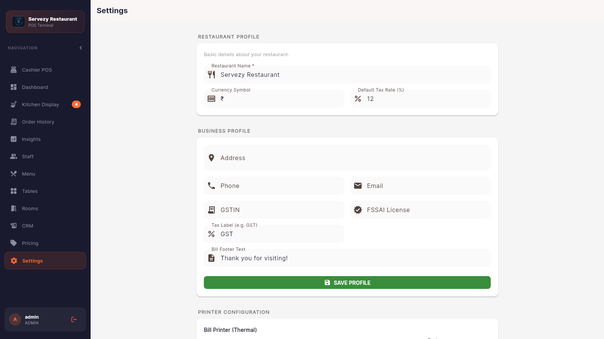 | 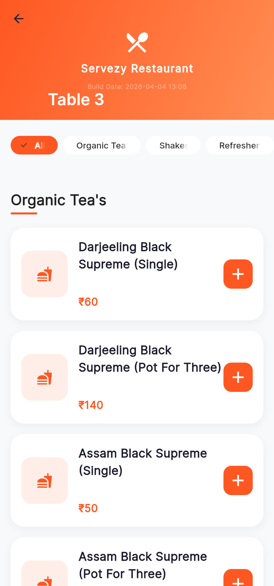 |

---

## 🚀 Key Features

### 🍽️ Interactive POS & Table Management
- **Visual Floor Plan**: Draggable and customizable table layouts. Arrange your restaurant floor visually in settings.
- **Smart Table Selection**: Quick filters for All, Available, and Occupied tables.
- **Order Merging**: Seamlessly add items to existing orders on occupied tables with "PREVIOUS" item indicators.
- **Customer Tracking**: Capture customer names and phone numbers during order entry.
- **Item Notes**: Add custom preparation instructions (e.g., "Extra Spicy", "No Onion") per item.

### 🍳 Kitchen Display System (KDS)
- **Real-time Synchronization**: Instant order arrival via WebSockets.
- **Sound Notifications**: Audio alerts for new orders to ensure kitchen awareness.
- **Order Status Management**: Track orders through "Pending", "Preparing", and "Ready" statuses.
- **High Visibility**: Chef-optimized cards showing quantities, table numbers, and custom notes.

### 📦 Inventory & Stock Control
- **Real-time Tracking**: Stock levels decrement automatically as orders are placed.
- **Low Stock Alerts**: Visual warnings on the POS screen and a dedicated dashboard alert list for items below threshold.
- **Menu Management**: Easy-to-use interface for adding/updating menu items, categories and kitchen counters.

### 💾 Offline-First Architecture
- **Local Caching**: Menu data and settings are cached locally using `Hive`.
- **Offline Queue**: Place orders even if the network goes down; the system syncs with the server when connectivity is restored.
- **Online/Offline Status**: Real-time connectivity indicator in the POS header.
- **LAN Discovery**: Terminals find the server automatically via Zeroconf/mDNS.

### 📊 Business Intelligence
- **Daily Performance Hub**: Today's Revenue, Total Order Count, Avg Order Value and Pending Orders.
- **Sales by Category & Tax Summary**: GST breakdown (CGST/SGST) and category-wise revenue.
- **Trends**: Revenue charts and order-status distribution using `fl_chart`.
- **Exports**: Download reports as Excel / PDF / CSV.

### 💎 Customer Loyalty & Rewards
- **Persistent Database**: Automatic customer profile creation and lookup via phone number.
- **Point Accrual**: Automated reward point tracking (1 pt for every ₹100 spent).
- **Point Redemption**: Redeem points for instant discounts within the POS.

### 💳 Payments & Billing
- **Split Payments**: Cash, Card and UPI.
- **e-Bill Sharing**: Send formatted digital receipts via WhatsApp/SMS.
- **Thermal Printing**: KOT and bill printing over network (ESC/POS) or Windows printers.

### 📱 Self-Service QR Ordering
- **Digital Menu**: Table-specific QR codes link guests to a mobile-responsive menu.
- **Autonomous Ordering**: Guests can place orders directly to the kitchen without staff intervention.

### 👥 Staff Management
- **Attendance System**: Clock-in/Clock-out shift tracking for all employees.
- **Role-Based Access**: Specialized views for Admins, Managers, Cashiers, Captains and Kitchen staff.
- **Tip Tracking**: Transparent logging of staff tips and earnings.

---

## 🛠️ Tech Stack

| Layer | Technology |
|---|---|
| Frontend | Flutter (Windows desktop + Web), Riverpod 2, fl_chart, Hive, Dio |
| Backend | Python, FastAPI, SQLAlchemy (ORM), WebSockets, Uvicorn |
| Database | SQLite (WAL mode, local-first) |
| Packaging | PyInstaller (server EXE), Inno Setup (Windows installer) |

---

## 📁 Project Structure

```
restaurant-pos/
├── backend/                 # FastAPI server (Python package)
│   ├── api/                 # Route handlers (orders, kitchen, billing, menu, staff, ...)
│   ├── commands/            # Command handlers (CQRS-style write operations)
│   ├── database/            # SQLAlchemy engine/session setup
│   ├── events/              # Event bus (WebSocket broadcasts)
│   ├── migrations/          # Schema migrations
│   ├── models/              # SQLAlchemy models
│   ├── schemas/             # Pydantic request/response schemas
│   ├── scripts/             # Backend seed scripts
│   ├── security/            # JWT auth & dependencies
│   ├── services/            # Business logic (billing, inventory, loyalty, printing, license, ...)
│   ├── utils/               # Excel/PDF/CSV generators, logger
│   └── main.py              # FastAPI app
├── frontend/
│   └── app/                 # Flutter application (desktop terminal + web guest menu)
│       └── lib/
│           ├── screens/     # POS, KDS, dashboard, reports, settings, ...
│           ├── services/    # API client, sync, printing, websockets
│           ├── models/  widgets/  core/  utils/
│           └── main.dart
├── scripts/                 # Maintenance scripts (run from repo root with `python -m`)
│   ├── db/                  # Migrations, fixes, checks, recovery
│   ├── seed/                # Seed users, rooms, inventory, recipes
│   ├── assets/              # Icon / logo / installer bitmap generation
│   └── dev/                 # One-off code patch helpers
├── tests/manual/            # Manual API / printer test scripts
├── tools/license/           # Private license key generator
├── packaging/               # PyInstaller spec, Inno Setup script, build script, app icon
├── docs/screenshots/        # README screenshots
├── main.py                  # Production server launcher (PyInstaller entry point)
└── requirements.txt
```

---

## ⚙️ Setup

### Backend
Run all commands from the **repo root**:

```bash
python -m venv .venv
.venv\Scripts\activate            # Windows
pip install -r requirements.txt

# Start the API server (dev)
uvicorn backend.main:app --host 0.0.0.0 --port 8000
```

The SQLite database (`restaurant_pos.db`) is created in the repo root on first run. API docs: http://127.0.0.1:8000/docs

**License salt:** the activation-key salt is not committed. Provide it either via the `SERVEZY_LICENSE_SALT` environment variable or by copying `backend/services/_license_secret.example.py` to `backend/services/_license_secret.py` and setting your value.

### Frontend
```bash
cd frontend/app
flutter pub get
flutter run -d windows      # POS terminal
flutter build web           # Guest QR menu (served by the backend at /)
```

### Maintenance scripts
Scripts live under `scripts/` and expect to be run from the repo root as modules, e.g.:

```bash
python -m scripts.seed.reset_admin
python -m scripts.db.repair_db
python -m tools.license.key_generator
```

---

## 🚢 Building a Release

`packaging/build_and_deploy.bat` builds everything (Flutter Windows + Web, PyInstaller server) and syncs it into `DEPLOY/`:

```bash
packaging\build_and_deploy.bat
```

Then open `packaging/servezy_installer.iss` in **Inno Setup** and compile (F9). The installer is written to `release/Servezy_Setup.exe`.

---

## 🔮 Roadmap

- [ ] **Cloud Sync**: Optional PostgreSQL/Cloud backup for multi-store coordination.
- [ ] **AI Forecasting**: Predictive inventory ordering based on historical sales trends.
- [ ] **Mobile App**: Native Android/iOS companion app for managers.

---

*Handcrafted for a premium restaurant experience.*
